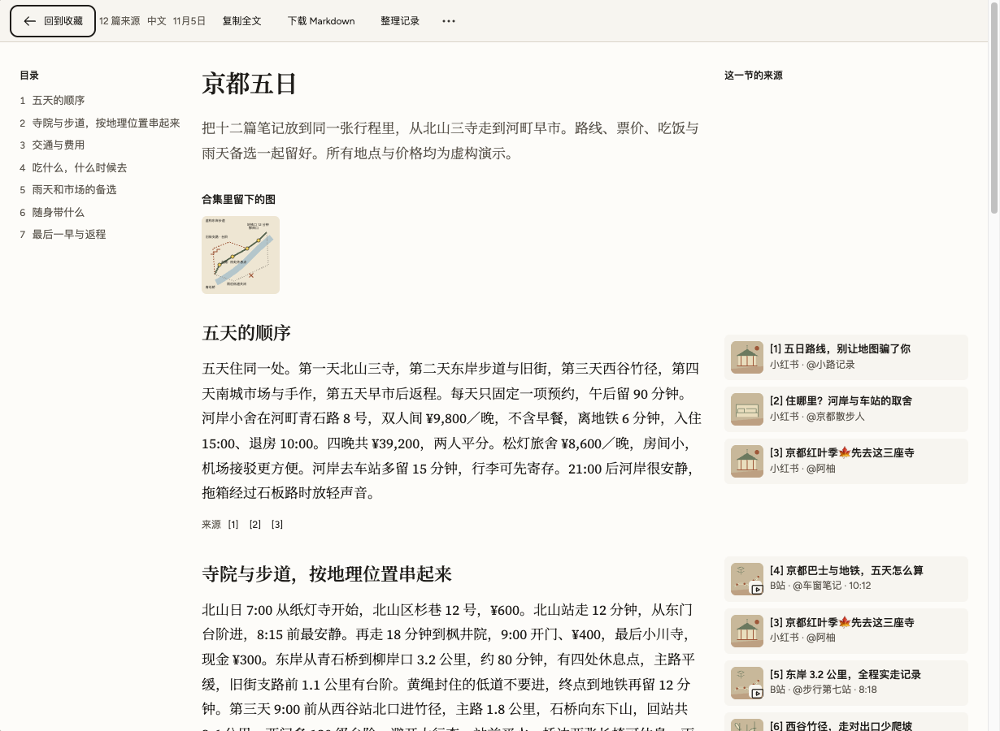

# Clipbind

**Read saved Xiaohongshu and Bilibili notes as one piece, with links back to its sources.**

For people whose useful saved posts are scattered across two platforms. Save immediately, find a topic pile, then bind its notes into a guide with numbered sources.

**[Try the live demo](https://nickkklian.github.io/content-organizer/?demo=1)**. It has 36 AI-written sample notes with real public place names in English and Chinese. Kyoto’s 12 sources are archived under its finished guide; the eight food notes are ready to bind. Open the Kyoto guide and follow source **[4]** to a video transcript. Selecting either prepared topic set replays its saved result. The demo labels the replay and makes no live AI request.



## Quick start

Use the demo above, or serve a clone locally (Python 3, no packages):

```sh
git clone https://github.com/NickkkLian/content-organizer.git
cd content-organizer
python3 -m http.server 8000
```

Open **http://localhost:8000/?demo=1**. The app is static, with no build step, and your notes live in this browser. Syncing needs your own private GitHub repository and token; generating a new guide needs an Anthropic key and sends the selected notes to Anthropic (see [Running it locally](#running-it-locally)).

## What it does

- **Capture** — paste a link, share text or a video ID into one field and choose **Save**. The capture is kept before fetching starts. Failed reads retain the text and link, with a place to paste the body and retry. Video transcription uses the optional local service.
- **Organise** — automatic categorisation by keyword scoring (tags weigh more than titles, titles
  more than body), platform / type / category filters, search, archive, Markdown and JSON export.
- **Consolidate** — tick several notes and let Claude merge them into one piece: de-duplicated,
  grouped into sections, with every section pointing back at its sources. Images can be sent along
  so text inside menus, slides and price lists ends up in the write-up; the model also decides which
  images are worth keeping because text can't replace them.
- **Read it** — a guide opens in a full-screen reader with a contents list, measured text column and sources beside each section. A citation opens the saved note with its body, transcript, images and original link. **How it was made** shows which notes fed each section. Edit the guide where you read it.
- **Keep it** — images on Xiaohongshu's CDN carry a signed expiry; the app archives them into your
  private repo so saved notes don't rot, and offers a one-click repair for notes whose links already
  died.
- **Take it with you** — **Copy as text** puts the full Markdown text on the clipboard. **Download Markdown** saves that same text as a file. Both use the existing exporter and keep shared source numbering. Notes-only downloads and image repair are in the library tools menu. Binding moves source notes to **Archive**, with **Restore them** available afterwards.

The compilation export is text with its numbered sources; images are not embedded.

## The reading view

A compilation is a piece of writing, and the card grid it was made in is a filing cabinet: four folded
cards to a row, every section expanded inside a quarter of the window, the buttons that re-run and
delete it directly underneath. **Read** opens it in its own surface instead — sections in reading
order down a measured column, a table of contents beside them, and one numbered list of everything
the piece was made from.

Building that list is the part with rules, so it is `js/refs.js` and it has cases:

- the URL is the identity and the title is the fallback, because one post cited by three sections
  under slightly different titles is one entry in the list, not three;
- numbering follows first appearance in reading order, so `[1]` is the first source the reader meets;
- a source with neither URL nor title is dropped — there is nothing for the number to point at;
- a note that was consolidated in but that no section cites is still listed, after the cited ones and
  marked, because it did go into the piece.

## How a pile of saved posts becomes one piece

```mermaid
%%{init: {"theme": "base", "themeVariables": {"darkMode": false, "fontFamily": "Inter, BlinkMacSystemFont, Segoe UI, Helvetica Neue, Helvetica, Arial", "primaryColor": "#dae7db", "mainBkg": "#dae7db", "primaryTextColor": "#1d1b24", "nodeTextColor": "#1d1b24", "textColor": "#1d1b24", "primaryBorderColor": "#2f5859", "nodeBorder": "#2f5859", "secondaryColor": "#fae8eb", "tertiaryColor": "#f7e9e8", "lineColor": "#5f7f76", "arrowheadColor": "#5f7f76", "defaultLinkColor": "#5f7f76", "edgeLabelBackground": "#fae8eb", "clusterBkg": "#f7e9e8", "clusterBorder": "#a8707a", "titleColor": "#7d2d44"}}}%%
flowchart LR
  X["Xiaohongshu link<br/>or pasted text"] --> P[parse.js]
  V["Bilibili / XHS video"] --> L["local/content_server.py<br/>yt-dlp + whisper + frames"]
  L --> P
  P --> C[classify.js]
  C --> S[("store.js<br/>IndexedDB")]
  S <-->|"content.json<br/>merge.js"| G[("your private repo")]
  S -->|"tick several notes"| A["ai.js<br/>Claude, JSON schema"]
  A --> K["compilation<br/>sections + source_indices"]
  K --> R["refs.js<br/>numbered sources"]
  R --> D["reading view"]
  S -->|"images.js"| G
```



## How it's built

Vanilla JS modules with no bundler and no build step. Notes are kept in IndexedDB and sync as one `content.json` in your private GitHub repo; the merge combines both sides' notes, lets deletions win and takes the latest edit, so several devices can write at once. Guides come from the Claude Messages API with structured output (a JSON schema), so the sectioned result never needs parsing heuristics. Videos go through an optional local service (`yt-dlp`, `faster-whisper` and key frames, judged by Claude vision in the browser). The GitHub token, Anthropic key and local service token live only in this browser's storage.

The full table of design decisions, the file map and the notes worth reading in the code are in [DOCS.md](DOCS.md).

## Running it locally

```bash
python3 -m http.server 8765        # then open http://localhost:8765/?demo=1
node check.mjs                     # 40 cases over the merge rules and the source list
```

Every other check (export, stylesheet, Content-Security-Policy, models, demo assets, capture) and what each one covers is listed in [DOCS.md](DOCS.md#checks).

Cloud sync and image archiving need a fine-grained GitHub token with Contents read/write on a private
repo of yours; AI features need an Anthropic API key. Both are entered under **Connections** and stored
only in the browser. The video service is optional — see [`local/README.md`](local/README.md).

The current replay data is generated by `node tools/build-demo.mjs`. The coding agent authored the four guides using the exact prompt and structured-output schema in `js/ai.js`. Each `demo/*.prompt-run.json` keeps the inputs, prompt, schema, result and hash. No live model API was used for this build. The 36 photographic covers were made with built-in image_gen, with adjacent prompts, licence and hashes. Public places are real; budgets are rough planning ranges. Source URLs and creator handles are fictional.

The older `make-demo-compilation.mjs` remains a standalone live-generation helper. Its output files are separate from the current replay bundle. Running that helper uses the caller's Anthropic key.

## Limitations

- Xiaohongshu fetching is best-effort through public proxies and fails on login walls; manual paste
  always works.
- Categorisation is keyword-based and tuned for Chinese content; English notes mostly land in "Other"
  unless they carry Chinese tags.
- Calling the Anthropic API from a browser requires the `anthropic-dangerous-direct-browser-access`
  header; the key never leaves your machine, but this is a personal-tool trade-off, not a pattern for
  multi-user products.
- `check.mjs` covers merge and source identity. `check-redesign.mjs` covers the library view rules and demo sets. Live proxy availability, local transcription and model output still depend on their external services.
- A compilation is what one model run produced. Re-running **Re-organize** tightens it, and editing it by
  hand is the other half of that — neither is a claim that the result is right.
- Browser-stored credentials share this GitHub Pages origin with the author's other apps; use your own hosting for an isolated origin.
- In the compilation export, Markdown and HTML in the saved text stay literal, as in the reading view. Only HTTP(S) sources become links; other source addresses remain text. Connection settings are never included. As with copying any document, review its text and source URLs before sharing it.

## License

MIT.
