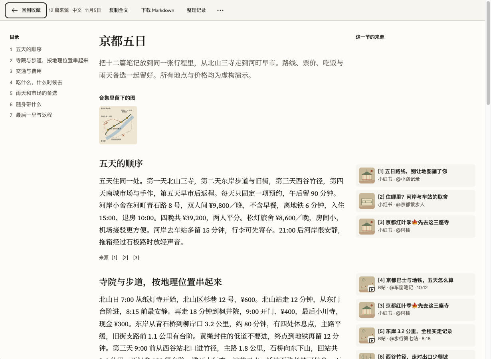

# Clipbind

**Read saved Xiaohongshu and Bilibili notes as one piece, with links back to its sources.**

For people whose useful saved posts are scattered across two platforms. Save immediately, find a topic pile, then bind its notes into a guide with numbered sources.

**[Try the live demo](https://nickkklian.github.io/content-organizer/?demo=1)**. It has 36 fictional notes and finished Kyoto and food guides in English and Chinese. Open the Kyoto guide and follow source **[4]** to a video transcript. Selecting either prepared topic set replays its saved result. The demo labels the replay and makes no live AI request.



## Quick start

Use the demo above, or serve a clone locally (Python 3, no packages):

```sh
git clone https://github.com/NickkkLian/content-organizer.git
cd content-organizer
python3 -m http.server 8000
```

Open **http://localhost:8000/?demo=1**. The app is static, with no build step. Notes live in this browser; syncing them requires your own private GitHub repository and token. Generating a new compilation requires an Anthropic key and sends the selected notes to Anthropic. Link capture uses public reader proxies; manual paste is available when a page cannot be fetched. Video transcription is an optional local service. Browser-stored credentials share this GitHub Pages origin with the author's other apps; use your own hosting for an isolated origin.

## What it does

- **Capture** — paste a link, share text or a video ID into one field and choose **Save**. The capture is kept before fetching starts. Failed reads retain the text and link, with a place to paste the body and retry. Video transcription uses the optional local service.
- **Organise** — automatic categorisation by keyword scoring (tags weigh more than titles, titles
  more than body), platform / type / category filters, search, archive, Markdown and JSON export.
- **Consolidate** — tick several notes and let Claude merge them into one piece: de-duplicated,
  grouped into sections, with every section pointing back at its sources. Images can be sent along
  so text inside menus, slides and price lists ends up in the write-up; the model also decides which
  images are worth keeping because text can't replace them.
- **Read it** — a guide opens in a full-screen reader with a contents list, measured text column and sources beside each section. A citation opens the saved note with its body, transcript, images and original link. **How it was made** shows which notes fed each section. Edit the guide where you read it.
- **Keep it** — images on Xiaohongshu's CDN carry a signed expiry; the app archives them into your
  private repo so saved notes don't rot, and offers a one-click repair for notes whose links already
  died.
- **Take it with you** — **Copy as text** puts the full Markdown text on the clipboard. **Download Markdown** saves that same text as a file. Both use the existing exporter and keep shared source numbering. Notes-only downloads and image repair are in the library tools menu. Binding moves source notes to **Archive**, with **Restore them** available afterwards.

The compilation export is a text artifact: images are not embedded. Markdown and HTML in the saved text
stay literal, as in the reading view. Only HTTP(S) sources become links; other source addresses remain
text. Connection settings are never included. As with copying any document, review its text and source
URLs before sharing it.

## How it's built

| Concern | Approach |
|---|---|
| Front end | Vanilla JS modules, one HTML file, no bundler. Loads in the order `i18n → samples → classify → parse → merge → refs → export → store → sync → images → fetch → ai → app` |
| Rules under test | The two things that would fail silently are pure functions in files of their own, DOM-free, loaded by the browser with `<script>` and by node with `require` — the file the browser runs is the file the tests run. `js/merge.js` is what happens when two devices have both written; `js/refs.js` is the numbered source list the reading view prints. `node check.mjs` runs 40 cases; `node check.mjs --break` breaks each rule in a copy and requires **the case written for it** to be the one that fails |
| Stylesheet under test | `node tools/check-css.mjs`: every class the app puts on an element has a rule, every rule is for a class it renders. Written after a restyle silently dropped the rules for twenty-two classes — error messages rendered in the neutral information style and nothing threw |
| Content-Security-Policy | A `<meta>` right after `<meta charset>`: scripts only from this site's own files and from the page's two inline scripts, pinned by sha256; no `'unsafe-inline'`, no `'unsafe-eval'`. The keys this app keeps in the browser share an origin with the author's other GitHub Pages sites, and the library shows text saved from other sites, so the browser itself refuses a script from another host, text run as code and inline event handlers. There is no build step: `node check-csp.mjs --write` computes the hashes and `node check-csp.mjs` (in CI) fails when the policy is missing, loosened or out of step with the page |
| Local storage | IndexedDB, with a one-time migration from localStorage. The origin hosts many apps and the ~5 MB localStorage quota is shared, so transcripts were silently failing to save — the store now throws visibly instead |
| Cloud sync | A single `content.json` in a private GitHub repo via the Contents API. Merge is union + tombstones + latest-`savedAt`-wins, so several devices can write concurrently; a `sha` conflict triggers one re-pull-and-retry |
| Image archiving | Fetched through an image proxy (CORS), compressed to 1080px WebP, committed to the repo; rendered back as blob URLs with the token. A cache-key subtlety with GitHub's `Accept`-negotiated responses is documented inline in `js/images.js` |
| AI | Claude Messages API called directly from the browser with **structured output** (a JSON schema), so the sectioned result never needs parsing heuristics. Output language follows the UI language |
| Video ingest | `local/content_server.py` — a tiny HTTP service on `127.0.0.1` that uses `yt-dlp` (with your browser cookies), `faster-whisper` for transcription and PyAV for key frames, streaming progress over **Server-Sent Events**. It returns candidate frames only; Claude vision in the browser judges which are informative |
| Secrets | GitHub token, Anthropic key and the local service token live only in this browser's storage. Nothing is ever written into a repo |
| Language | English by default, 中文 via the toggle; the preference is remembered in localStorage |

```
index.html            shell; static strings carry data-i18n keys
styles.css            topic rail, cover rows, preview and bind tray, source-linked reader, phone sheets
js/i18n.js            dictionary + T(zh, en) helper
js/samples.js         36 fictional notes in each language, including two long video transcripts
js/library.js         search snippets, topic-tag counts and exact demo replay sets
js/classify.js        keyword categoriser (Chinese keywords — the content is Chinese)
js/parse.js           Xiaohongshu fetch chain: Jina HTML → Jina markdown → AllOrigins → manual
js/merge.js           the merge rules: union by id, tombstones win, latest savedAt wins (DOM-free, tested)
js/refs.js            one numbered source list per compilation, and the numbers each section cites (DOM-free, tested)
js/export.js          saved compilation Markdown; reuses refs, with no connection or AI dependencies
js/store.js           IndexedDB store with synchronous API and localStorage fallback
js/sync.js            private-repo sync, tombstone merge, legacy bootstrap
js/images.js          archiving, expiry detection, proxy fallbacks, vision sizing
js/fetch.js           client for the local video service (EventSource)
js/ai.js              consolidation + frame judging (structured outputs)
js/app.js             UI, sample data, event wiring
demo/                 two guides per language, exact prompt records and replay data
assets/fonts/         self-hosted Figtree, Source Serif 4 and sliced Noto Serif SC, with OFL licences
local/                the optional video service and its double-click toggle app (see local/README.md)
check.mjs             40 cases over js/merge.js and js/refs.js; --break has to make the right one fail
check-export.mjs      order, numbering, complete sources, language, escaping, settings exclusion, empty and large exports
tools/check-css.mjs   every rendered class has a rule, every rule is rendered; --break deletes rules to show it goes red
check-csp.mjs         the page's Content-Security-Policy: --write puts it in, the default run checks it, --self-test breaks it
make-demo-compilation.mjs   runs the AI step once with your key and writes demo/compilation.json
```

## How a pile of saved posts becomes one piece

```mermaid
%%{init: {"theme": "base", "themeVariables": {"darkMode": false, "fontFamily": "Inter, BlinkMacSystemFont, Segoe UI, Helvetica Neue, Helvetica, Arial", "primaryColor": "#dae7db", "mainBkg": "#dae7db", "primaryTextColor": "#1d1b24", "nodeTextColor": "#1d1b24", "textColor": "#1d1b24", "primaryBorderColor": "#2f5859", "nodeBorder": "#2f5859", "secondaryColor": "#fae8eb", "tertiaryColor": "#f7e9e8", "lineColor": "#5f7f76", "arrowheadColor": "#5f7f76", "defaultLinkColor": "#5f7f76", "edgeLabelBackground": "#fae8eb", "clusterBkg": "#f7e9e8", "clusterBorder": "#a8707a", "titleColor": "#7d2d44"}}}%%
flowchart LR
  X["Xiaohongshu link<br/>or pasted text"] --> P[parse.js]
  V["Bilibili / XHS video"] --> L["local/content_server.py<br/>yt-dlp + whisper + frames"]
  L --> P
  P --> C[classify.js]
  C --> S[("store.js<br/>IndexedDB")]
  S <-->|"content.json<br/>merge.js"| G[("your private repo")]
  S -->|"tick several notes"| A["ai.js<br/>Claude, JSON schema"]
  A --> K["compilation<br/>sections + source_indices"]
  K --> R["refs.js<br/>numbered sources"]
  R --> D["reading view"]
  S -->|"images.js"| G
```



## The reading view

A compilation is a piece of writing, and the card grid it was made in is a filing cabinet: four folded
cards to a row, every section expanded inside a quarter of the window, the buttons that re-run and
delete it directly underneath. **Read** opens it in its own surface instead — sections in reading
order down a measured column, a table of contents beside them, and one numbered list of everything
the piece was made from.

Building that list is the part with rules, so it is `js/refs.js` and it has cases:

- the URL is the identity and the title is the fallback, because one post cited by three sections
  under slightly different titles is one entry in the list, not three;
- numbering follows first appearance in reading order, so `[1]` is the first source the reader meets;
- a source with neither URL nor title is dropped — there is nothing for the number to point at;
- a note that was consolidated in but that no section cites is still listed, after the cited ones and
  marked, because it did go into the piece.

Those four decisions are also the four breaks `node check.mjs --break` makes in it.

## Design notes worth reading in the code

- `js/store.js` — why put/get must be separate helpers, and why a failed write must throw rather than
  return.
- `js/images.js` — why the sha-lookup request uses `cache: 'no-store'`: Chrome cached a raw WebP
  under the same URL and a later JSON request received image bytes.
- `styles.css` — why the grid uses `minmax(0, 1fr)`: with real cards, `1fr` let a column grow to
  668px on a 375px phone, and an empty library can't reveal it.
- `local/content_server.py` — the measured frame-difference thresholds behind `SCENE_THR`.

## Running it locally

```bash
python3 -m http.server 8765        # then open http://localhost:8765/?demo=1
node check.mjs                     # 40 cases over the merge rules and the source list
node check.mjs --break             # breaks each rule; the case written for it has to be the one that fails
node check-export.mjs              # portable compilation Markdown and source-list parity
node tools/check-css.mjs           # every rendered class has a rule, and back
node tools/check-css.mjs --break   # deletes rules to show the check can go red
node check-csp.mjs                 # the Content-Security-Policy is script-src 'self' + the inline scripts' hashes
node check-csp.mjs --write         # after editing an inline script in index.html: update the hashes
node check-models.mjs              # every AI request names Claude Opus 5.5, Sonnet 5.5 or Haiku 5.5 (fetch replaced by a recorder)
node check-redesign.mjs            # classification, search, tag counts and bilingual replay data
node check-capture.mjs             # normal Save form, concurrent captures, offline video and failed writes
node --test test/*.test.mjs        # Settings contracts and migration
```

Cloud sync and image archiving need a fine-grained GitHub token with Contents read/write on a private
repo of yours; AI features need an Anthropic API key. Both are entered under **Connections** and stored
only in the browser. The video service is optional — see [`local/README.md`](local/README.md).

The current replay data is generated by `node tools/build-demo.mjs`. The coding agent authored the four guides using the exact prompt and structured-output schema in `js/ai.js`. Each `demo/*.prompt-run.json` keeps the inputs, prompt, schema, result and hash. No live model API was used for this build. The SVG covers are original drawings under MIT, with their generator beside the data. All venues, prices and source URLs are fictional.

The older `make-demo-compilation.mjs` remains a standalone live-generation helper. Its output files are separate from the current replay bundle. Running that helper uses the caller's Anthropic key.

## Limitations

- Xiaohongshu fetching is best-effort through public proxies and fails on login walls; manual paste
  always works.
- Categorisation is keyword-based and tuned for Chinese content; English notes mostly land in "Other"
  unless they carry Chinese tags.
- Calling the Anthropic API from a browser requires the `anthropic-dangerous-direct-browser-access`
  header; the key never leaves your machine, but this is a personal-tool trade-off, not a pattern for
  multi-user products.
- `check.mjs` covers merge and source identity. `check-redesign.mjs` covers the library view rules and demo sets. Live proxy availability, local transcription and model output still depend on their external services.
- A compilation is what one model run produced. Re-running **Re-organize** tightens it, and editing it by
  hand is the other half of that — neither is a claim that the result is right.

## License

MIT.
